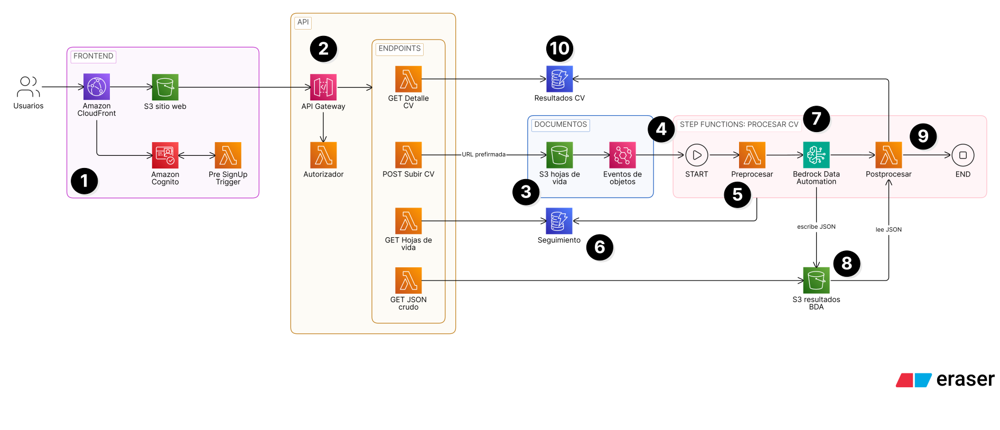

# ATS de hojas de vida con Amazon Bedrock Data Automation

Este repo contiene el código para la demo en vivo de la charla **"Introducción a Amazon Bedrock Data Automation"** para la comunidad de AWSWomen Colombia.

Al desplegarla, Una persona sube su hoja de vida a un portal web y, en menos de 2 minutos, el equipo de reclutamiento ve un perfil estructurado: contacto, experiencia, educación, habilidades, seniority inferido y un resumen en español, cada campo con su nivel de confianza.

## Arquitectura



**Carga de la hoja de vida**

1. La persona entra por **Amazon CloudFront** al sitio web en **Amazon S3** e inicia sesión con el login administrado de **Amazon Cognito**. Un trigger **Pre SignUp** solo deja registrarse a los correos autorizados y uno **Post Confirmation** agrega al grupo `reclutamiento` los correos configurados.
2. El sitio llama a **Amazon API Gateway**. Una **AWS Lambda** autorizadora valida el token de Cognito y cada endpoint es su propia función **Lambda**.
3. El endpoint **POST Subir CV** entrega una URL prefirmada y el navegador sube el archivo directo al bucket de hojas de vida en **Amazon S3** (`entrada/`).
4. El evento **Object Created** de S3 llega a **Amazon EventBridge**, que inicia el flujo en **AWS Step Functions**.

**Procesamiento con BDA**

5. La **Lambda** Preprocesar valida el formato y el tamaño, y registra el documento y quién lo subió.
6. La tabla **Seguimiento** en **Amazon DynamoDB** guarda el estado de cada hoja de vida (`PENDIENTE`, `PROCESADO` o `FALLIDO`) y su línea de tiempo, para que la app lo muestre en vivo.
7. Un paso nativo de Step Functions inicia un job asíncrono de **Amazon Bedrock Data Automation** con el blueprint **hoja-de-vida** y consulta su estado cada 5 segundos hasta que termina.
8. **BDA** escribe la salida estándar y la personalizada (campos, valores inferidos, confianza y cajas de ubicación) como JSON en un segundo bucket de **Amazon S3** (`bda/`).
9. La **Lambda** Postprocesar lee el JSON, calcula la confianza por campo, marca los campos para revisión humana, estima el costo y cierra el flujo.

**Consulta de resultados**

10. La tabla **Resultados CV** en **DynamoDB** guarda el perfil estructurado. Los endpoints **GET** muestran a cada persona sus hojas de vida y al equipo de reclutamiento todas; el archivo original y el JSON crudo de BDA llegan al navegador con URLs prefirmadas.

| Carpeta | Contenido |
|---|---|
| `infra/` | CDK v2 en Python: `app.py`, `bda_ats/stack.py` y un construct por capa en `bda_ats/constructos/`, máquina de estados en JSONata armada con constructs en `constructos/flujo.py` |
| `backend/` | Lambdas Python 3.13 (`funciones/*/app.py`), código compartido en `comun/`, pruebas en `tests/` |
| `blueprints/` | Blueprint `hoja-de-vida` de BDA |
| `frontend/` | React + Vite + TypeScript con Cloudscape, login administrado de Cognito (Amplify Auth) y visor de documentos con PDF.js |
| `muestras/` | Carpeta para las hojas de vida de prueba (no se versionan) |

## Requisitos

- Python con [uv](https://docs.astral.sh/uv/), Node.js 22+ con pnpm, AWS CLI v2 y AWS CDK CLI (`cdk --version`).
- Cuenta AWS con acceso a Bedrock Data Automation en **us-east-1**.

## Preparar el entorno

```bash
# 1. Configuración local (acá lo tratamos como un .env estructurado)
cp config.json.example config.json
#    Ajusta: cuenta, tags, registro.correos_permitidos / dominios_permitidos / correos_reclutamiento

# 2. Dependencias
uv sync
pnpm --dir frontend install
```

### `config.json`

| Llave | Para qué sirve |
|---|---|
| `cuenta`, `region` | Cuenta y región del stack (us-east-1) |
| `prefijo` | Prefijo de nombres (blueprint, proyecto, máquina de estados) y del dominio del login de Cognito (`<prefijo>-<cuenta>`) |
| `tags` | Tags que se aplican a todos los recursos; el synth falla si está vacío |
| `nag` | Activa cada paquete de cdk-nag (todos en `false` para el demo) |
| `registro` | `correos_permitidos` (direcciones exactas) y `dominios_permitidos` pueden crear cuenta (Pre SignUp); `correos_reclutamiento` entran al grupo `reclutamiento` al confirmar la cuenta |
| `bda` | Perfil de BDA, segundos entre consultas de estado y máximo de consultas |
| `confianza` | Umbrales de los niveles Alta y Media que muestra la app |
| `precios_usd` | Precios para el costo estimado por hoja de vida |

## Verificar

```bash
uv run ruff check .
uv run pytest                 # backend + infra (synth sin frontend)
pnpm --dir frontend lint
pnpm --dir frontend test
pnpm --dir frontend build
cdk synth                     # compila el frontend (pnpm install + build) y sintetiza; este paso no requiere credenciales y no cuesta
```

## Desplegar

```bash
cdk bootstrap aws://<cuenta>/us-east-1   # una sola vez por cuenta y región, esto SÍ requiere cuenta y credenciales aws, usa profiles y la flag --profile por seguridad
cdk deploy # esto despliega TODO, no cuesta mucho si se deja desplegado, asegúrate de contar con las credenciales y la cuenta correcta 
```

La salida `SitioUrl` es la URL de la app. Regístrate con un correo de la lista permitida; Cognito envía un código de verificación.

CORS y las URLs de retorno del login solo aceptan el dominio de CloudFront, así que la app se prueba desplegada y probar en localhost requerirá qie agregues la regla al CORS.

## Correr el demo

1. Abre `SitioUrl` y pulsa **Iniciar sesión o registrarse**: Cognito muestra su login administrado (en español). Regístrate con un correo de la lista; Cognito envía un código de verificación.
2. En **Subir hojas de vida** sube varias a la vez (PDF, DOCX, JPG, PNG o TIFF).
3. **Mis hojas de vida** muestra tus documentos en `Pendiente`; en el detalle, la línea de tiempo y el enlace a la ejecución de Step Functions (el ciclo `EsperarBda → ConsultarEstadoBda`).
4. Al terminar, el detalle muestra el documento con las cajas de cada campo, la tabla de hallazgos con su confianza (Alta / Media / Baja), el JSON crudo y el markdown de BDA, y el perfil.
5. Con un correo de `correos_reclutamiento` aparece **Todas las candidaturas**: todas las corridas de todas las personas, útil como respaldo si algo falla en vivo.

## Limpiar

```bash
cdk destroy
```

Todos los recursos tienen `RemovalPolicy.DESTROY` y los buckets se vacían solos. Puedes revisar el progreso más a detalle en tu cuenta de AWS en el servicio de CloudFormation

## Costo

BDA cobra USD 0.040 por página con custom output (incluye la salida estándar). Una hoja de vida de una página cuesta unos USD 0.04. El resto de servicios queda en capa gratuita o en centavos para el volumen del demo. **Aproximadamente cuesta 1 USD por cada 25 páginas de PDF Analizadas**
